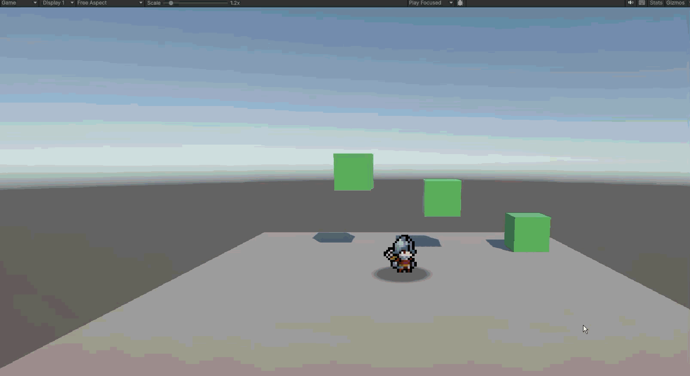

When I was 9 years old, I remember having a blast playing Halo 3 custom games with my buddies online. 
Years later, when I was in high school, I would put my Xbox controller in my backpack on Friday morning.
After school ended, I would get off the bus at my friends stop, and we would stop by the store to get
junk food before heading to his house and playing games together all night. For as long as I can
remember, video games have played an important role in my life as a form of entertainment and
sharing fun experiences with friends. That's why being a game developer has always been my true
passion.

## Chasing My Dream

Lately, I have put much thought into what comes next. My first major decision was to begin and 
complete college. One of my best friends, who is also my biggest role-model, told me "follow your
passion above all else." I believe a Bachelors in Computer Science will best fit my goal of
being a game developer, but if we learned anything from John Carmack, we know that college doesn't
inherently make you a skilled developer. 

## A Star Wars Quote to Live By:

*"Experience outranks everything" - Captain Rex in Star Wars: The Clone Wars.* I know it seems 
silly to take wisdom from a fictional animated character, but I couldn't have said it any better.
It's no secret that the best way to get good at something, is by doing that thing, which is why I
started building my own game.

## Stunning 10/10 Gameplay

The idea for the game is a 2.5D choice-based puzzle game about a robot (I know that's not a robot
in the demo) who must learn and understand human emotions. The game is in its infancy and I'm very 
excited to keep working on it. I can't wait to show a more playable state of the game soon. 

## Signing Off
I'm glad I could show you the beginning of my next big project, and update everyone on my 
direction for college. I hope you're as excited as I am for the future of this game. Keep checking
my blog for updates and I may even create a timeline/roadmap page for my projects to help myself
and others track my work progress with clean visuals, but that's a tomorrow problem. Until next time!

Goodbye For Now.

<iframe width="560" height="315" src="https://www.youtube.com/embed/pjl7xtoFp0U?si=OKlqrm8DtPvjmCgI" title="YouTube video player" frameborder="0" allow="accelerometer; autoplay; clipboard-write; encrypted-media; gyroscope; picture-in-picture; web-share" referrerpolicy="strict-origin-when-cross-origin" allowfullscreen></iframe>