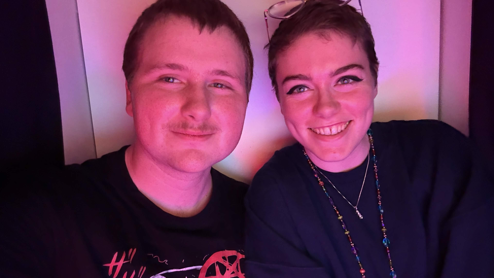

It's been a while, and here's why. When I was in the military, work took up so much of my time. I found it hard to stay focused on projects or study when I needed to.
There were so many things I wanted to do and so many projects to finish. I told myself I would get straight to work on everything I wanted to do over the years. Finish
old projects, start on new ones, and collaborate with my friends. Luckily, I have been doing all three, but not at the pace I imagined.

I finally landed a job and I start in about a month and a half. This allows me an abundance of free time. So what gives? I have so much time but my pace is so slow with
my projects. Why? laziness? *-maybe a little-* but mainly, I have been spending precious time enjoying home again.

## Stopping To Smell The Roses

 My wife and I grew up in Wilmington NC, and were finally back. I left home at 18 to join the Air Force and my lovely wife came with me. We took on life together, pulling each other
 back up after failure and keeping each other sane. We were two kids trying to figure out the world all on our own, which meant we had to grow up fast. Now after 6 years, were back to
 the place we grew up, and the town is **exactly** as fun and exciting as we remembered. 

 
 > Me and my wife in the WonderWorks House, Myrtle Beach during our six year anniversary

## So What About Gamedev?

Enough about me, lets talk about my work. I have been working on my 3D Physics-Based Platformer and it's finally reached an early alpha demo. Following the **AMAZING** tutorial 
series [CatlikeCoding](https://catlikecoding.com/unity/tutorials/movement/), I have learned how to create very solid movement for my character. It's been interesting learning about
dot products, normal vectors, and calculating velocity. It has **also** been very time consuming. There is **ALOT** that goes into moving a character, at least when you
want full control over everything. By the time its done, it should have movement mixed between Super Mario 64, Super Mario Galaxy, and Pseudoregalia. 
I can see now that this will be a long journey to finish this game.

However, let me tell you about a little discovery I have made. For one, pixel art is coming more naturally to me now, meaning I can make small assets with ease. Two, I have met
a new friend who creates games using GameMaker. You can find his website [here](https://www.farawaymoon.com/) I had never used GameMaker but when he showed me how it worked, 
I realized that its incredibly simple to create games using that engine. He also mentioned maybe collaborating and competing in some [Game Jams](https://itch.io/jams). 
I feel this would be a fun and interesting way to learn and work on more realistically sized projects. 

## What You Can Expect From Me
There will be a new page added to my website when the first game is complete. The new page will contain links/downloads to all the games I have completed, along with a timeline for future updates/games. 
By my next devlog, I should have a little something complete, but that will remain a mystery until the time is right. Until then, I hope you enjoy today's YouTube video by one of the game devs who inspired
me. Until next time!

Goodbye For Now.

<iframe width="560" height="315" src="https://www.youtube.com/embed/KyhrqbfEgfA?si=eoZplaC-tGf3f-9t" title="YouTube video player" frameborder="0" allow="accelerometer; autoplay; clipboard-write; encrypted-media; gyroscope; picture-in-picture; web-share" referrerpolicy="strict-origin-when-cross-origin" allowfullscreen></iframe>
